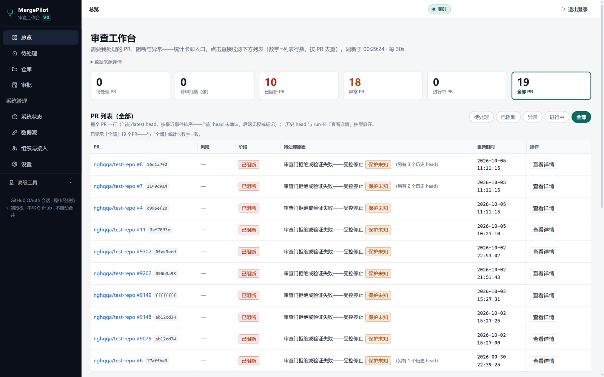
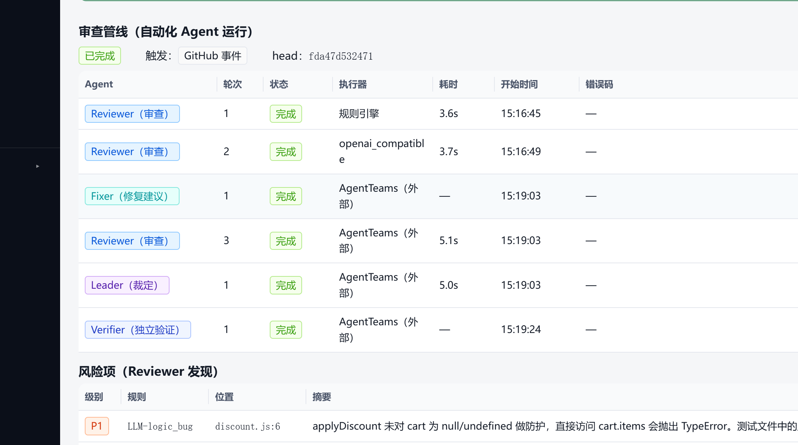
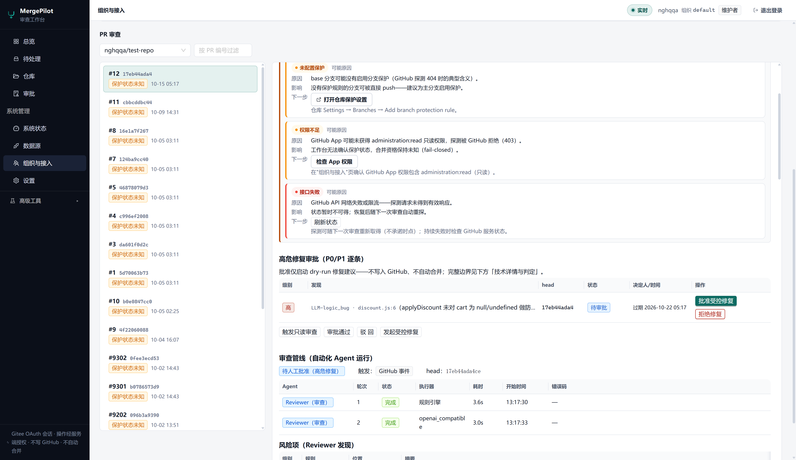
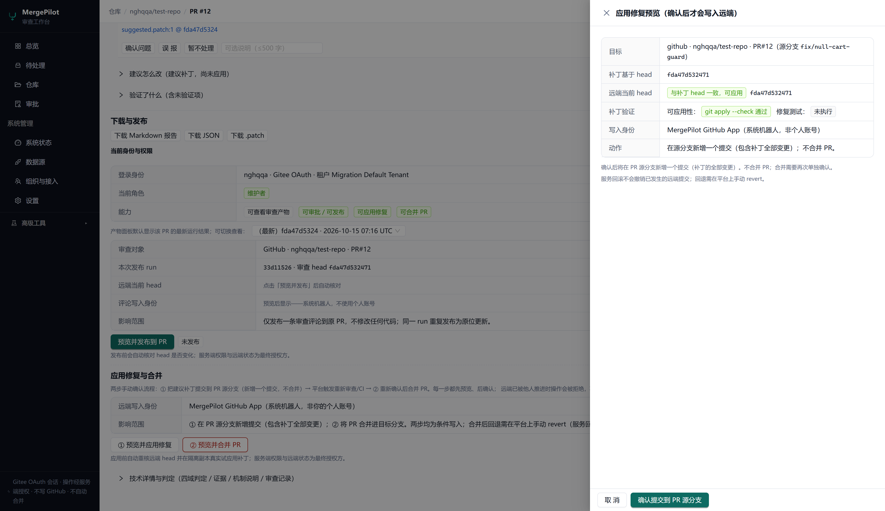
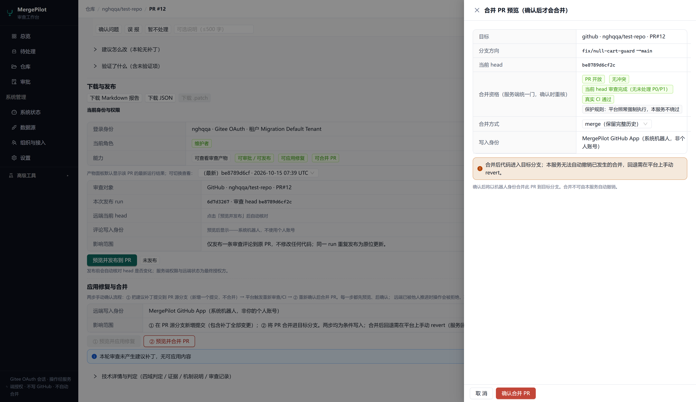

# MergePilot

**自托管的多 Agent PR 审查与受控变更工作台。审查留痕，远端写入与合并由维护者决定。**

[官网](https://docs.nghqqa.cn/) · [快速开始](https://docs.nghqqa.cn/quickstart.html) · [使用文档](https://docs.nghqqa.cn/docs.html) · [下载与校验](https://docs.nghqqa.cn/downloads.html)

[](https://github.com/nghqqa/MergePilot/releases/latest)
[](https://github.com/nghqqa/MergePilot/actions/workflows/console-backend.yml)
[](https://github.com/nghqqa/MergePilot/actions/workflows/selftest.yml)
[](https://github.com/nghqqa/MergePilot/actions/workflows/secret-scan.yml)
[](LICENSE)

MergePilot 接入你的仓库（GitHub App + Gitee 连接），把 PR 事件、审查发现（静态规则 +
LLM 第二阶段）、修复建议与验证证据汇集到你自己的 Console。维护者可在 Console 内逐次
「预览 → 确认」完成三类受控远端写：发布审查评论、**应用修复（机器人以自己的身份向 PR
分支提交修复 commit，新 head 自动重审）**、**确认合并（统一资格门：当前 head 审查完成
+ 真实 CI 通过 + mergeable 已知，缺一不放行）**。系统不自动改代码、不自动合并、不设
required check、不绕过平台保护。

当前最新发布版本为 **[rc.35.6-rc8.5](https://github.com/nghqqa/MergePilot/releases/tag/v0.2.0-beta.6-rc.35.6-rc8.5)**（事件投递与入口预检版，含 `rc8.4.1` 安全修复；源码 `3879e390`，Schema `v29`），能力边界见[能力矩阵](docs/delivery/CAPABILITY-MATRIX.md)。维护者生产实例已完成 GitHub/Gitee 四角色真实浏览器 OAuth 登录验收及 `rc8.5` 受控换版与 T+1h 连续观察验收，当前按[冻结协议](FROZEN.md)处于计划内停机保数状态；审批/修复应用/合并等受控写已在隔离实仓完成端到端验收，真实外部用户非空业务流量尚未发生。

## 界面与受控闭环速览



*点击下方缩略图可放大查看从「多角色审查 → 高危票据审批 → 预览应用修复 → 统一合并资格门」的完整实测界面：*

| ① 多角色审查管线与发现落库 | ② P0/P1 高危修复具名审批门 |
| --- | --- |
| [](docs/acceptance/rc35.5-first-use/evidence/07-403-binding-required-before-fix.png)<br><sub>规则引擎、外部模型与 AgentTeams（Fixer / Leader / Verifier）逐轮耗时、状态与结构化发现分列留痕</sub> | [](docs/acceptance/rc35.5-first-use/evidence/01-first-p1-ticket-pending.png)<br><sub>分支保护状态如实探测（未知即 fail-closed）；高危发现逐条生成具名审批票，全批准后才放行修复轮</sub> |
| **③ 应用修复两阶段预览（绑定 Head 与补丁摘要）** | **④ 统一合并资格门（拦截陈旧证据 → 重审全绿放行）** |
| [](docs/acceptance/rc35.5-first-use/evidence/05-apply-preview-drawer.png)<br><sub>确认前强制核对远端当前 head 与补丁基准一致，并在隔离副本实测 `git apply --check` 通过</sub> | [](docs/acceptance/rc35.5-first-use/evidence/03-merge-gate-all-green.png)<br><sub>新 commit 推送后[旧 head 证据自动失效阻断](docs/acceptance/rc35.5-first-use/evidence/02-merge-gate-blocked-review-missing.png)；仅当前 head 审查完成 + 真实 CI 通过才开放合并确认</sub> |

*注：总览图为 rc.16 测试环境历史数据（账号与组织已打码）；四宫格为隔离验收实仓 `PR #12` 端到端实测记录（详见 [FIRST-USE-ACCEPTANCE](docs/acceptance/rc35.5-first-use/FIRST-USE-ACCEPTANCE.md)）。*

## 核心工程设计（Architecture Highlights）

本项目重点解决企业引入 AI 参与代码变更时的**状态一致性、防越权控制面、零信任出站治理与不可抵赖审计**问题：

| 工程域 | 关键机制与边界保证 | 代码真源 |
| --- | --- | --- |
| **防 TOCTOU 两阶段远端写与未知态对账** | 评论、机器人提交修复、确认合并均经 `preview → confirm` 两步确认，强绑定 `expected_remote_head` + `expected_patch_digest`；写前落库持久化候选状态 + DB 原子认领防并发覆盖；远端超时/断连进入 `result_uncertain`，由读回对账端点按平台实际状态幂等定案 | [`fix-apply.mjs`](console/backend/lib/multiuser/fix-apply.mjs) · [`remote-write.mjs`](console/backend/lib/multiuser/remote-write.mjs) · [`publish.mjs`](console/backend/lib/multiuser/publish.mjs) |
| **零信任 LLM 出站治理与防注入隔离** | 租户级出站策略与同意记录门控（未授权零网络请求）；统一经 Context Builder 实施**正则族 + Shannon 熵（`>3.5`）双通道凭据掩码**（异常 fail-closed）；固定指令区与 `<<<UNTRUSTED_DATA` 信封物理隔离防范间接 Prompt 注入；审计仅落哈希清单，零源码副本留存 | [`context-builder.mjs`](console/backend/lib/multiuser/agents/context-builder.mjs) · [`external-reviewer.mjs`](console/backend/lib/multiuser/agents/external-reviewer.mjs) · [`egress-audit.mjs`](console/backend/lib/multiuser/agents/egress-audit.mjs) |
| **事件驱动状态机与 Matrix `/sync` 流式结算** | GitHub/Gitee Webhook 入队前契约预检与 delivery 幂等去重；PostgreSQL CAS 状态推进、Attempt 有限重试与死信队列（DLQ）；Worker→Console 结果经 Matrix `/sync` 游标持久化事件流秒级推送结算（支持断线续传、submissionId 幂等与多房间隔离），轮询降级为对账兜底 | [`review-service.mjs`](console/backend/lib/multiuser/review-service.mjs) · [`orchestration.mjs`](console/backend/lib/multiuser/orchestration.mjs) · [`matrix-sync-listener.mjs`](console/backend/lib/multiuser/agents/matrix-sync-listener.mjs) |
| **非递增五角色 RBAC 与多租户隔离** | Schema `v29` 核心业务表按 `tenant_id` 复合外键强制收窄，撤权后同会话下一请求即 `403`；五角色并非简单递增——**平台管理与业务裁定物理分离**，`platform_admin` 刻意无源码读取（`read_code_content`）及审批/应用/合并权限；邀请路径 API/Claim/DB CHECK 三层防提权 | [`authz.mjs`](console/backend/lib/multiuser/authz.mjs) · [`schema.mjs`](console/backend/lib/multiuser/schema.mjs) · [`fix-approval.mjs`](console/backend/lib/multiuser/fix-approval.mjs) |
| **多平台 Forge 契约与双面 CI 资格门** | 抽象规范事件 v1 与上下文完整性三态冻结；合并资格门同时分页核验 GitHub Commit Statuses **与** Check Runs 双面状态（任一读取失败或无 CI 运行均 fail-closed 阻断，绝不降级放行） | [`forge/index.mjs`](console/backend/lib/multiuser/forge/index.mjs) · [`forge/gitee.mjs`](console/backend/lib/multiuser/forge/gitee.mjs) · [`patch-applicability.mjs`](console/backend/lib/multiuser/patch-applicability.mjs) |
| **可验证软件供应链与原子换版回滚** | 官方镜像、PostgreSQL（pgvector）与嵌入 sidecar 全量钉死不可变 OCI Digest；随附 CycloneDX SBOM（48 组件）、SHA256SUMS 与 Trivy 零漏洞/零密钥扫描记录；配套多网络容器原子换版与一级回滚工具链 | [`Dockerfile.canonical-console`](docker/Dockerfile.canonical-console) · [`deploy/selfhost/`](deploy/selfhost/) · [`.github/workflows/console-backend.yml`](.github/workflows/console-backend.yml) |

## 它如何工作

PR 事件接入 → 审查发现 → 按策略进入修复与验证 → Console 展示结果。

四个 Agent 角色各司其职，不代表四个 LLM，也不代表每个 PR 都执行全部环节：

| 角色 | 职责 |
| --- | --- |
| Reviewer | 审查代码，产出发现与建议（确定性静态规则 + 可选外部模型第二阶段） |
| Fixer | 生成修复建议与验证证据（此阶段零远端写入） |
| Verifier | 独立验证，记录判定与证据（结构强制不读取 Fixer 自述推理） |
| Leader | 编排与裁决；内部确定性策略保留管线终裁权 |

内部 Leader 决定的是管线状态，**维护者决定的是是否应用与合并**。高危 finding 的修复需人工审批；
机器人提交与合并各自独立确认；Agent 的建议与可执行验证证据应分开看待。

- **团队协作**：GitHub / Gitee OAuth + 邀请制登录、五角色 RBAC、应用层多租户隔离与审计。
- **修复验证**：AgentTeams 执行器独立部署（`deploy/agentteams/qwenpaw-v124/install-agentteams-full.sh` 一键安装，console 侧经 `docker-compose.agentteams.yml` 声明式网络接线，重建免手工 connect）；未配置或不就绪时，该环节 fail-closed。
- **可选知识库**：本地 RAG 检索团队规范，结果仅作为参考，不自动成为审查结论。

## 项目维护状态

项目自 2026-10-26 起处于**事件响应维护**（2026-11-11 完成受控解冻轮并发布 `rc8.5` 后已恢复冻结）：`main` 仅接受安全补丁与文档事实同步类 PR，现有 CI 门不变；上游 HIGH/CRITICAL CVE、GitHub/Gitee 平台行为变更、真实用户故障或明确业务需求触发时按 [FROZEN.md](FROZEN.md) 的路径响应。当前推荐自托管版本为 [rc.35.6-rc8.5](https://github.com/nghqqa/MergePilot/releases/tag/v0.2.0-beta.6-rc.35.6-rc8.5)。

## 开始使用

Console、数据库和部署配置由你自行管理；官网是文档入口，**不是托管版 Console 或登录入口**。

1. 阅读[快速开始](https://docs.nghqqa.cn/quickstart.html)，准备 Docker Compose、Node.js ≥ 20、GitHub App、OAuth App 和审查用的 LLM 端点。
2. 选择 [rc.35.6-rc8.5 部署包](https://github.com/nghqqa/MergePilot/releases/tag/v0.2.0-beta.6-rc.35.6-rc8.5)（镜像 OCI index `ghcr.io/nghqqa/mergepilot-console@sha256:f8bc369f5b046536103d75ba53c4863871abb3ecddbdfe920baf29c6428afe9a`；离线 tar、SHA256SUMS、48 组件 SBOM 和扫描记录见该 Release 与[下载与校验](https://docs.nghqqa.cn/downloads.html)），或使用下面的仓库部署方式。
3. 按[部署指南](deploy/selfhost/README.md)完成配置和首管理员初始化，再登录你自己的 Console。**觉得安装手续太多？**把仓库里的 [INSTALL-WITH-AI.md](INSTALL-WITH-AI.md) 整段复制给你的 AI 编码助手，让它带你逐步执行（每步都有可校验判据），或遇到卡点把该文件与报错一起交给 AI 排障。
4. 日常使用与验收：[用户指南](docs/delivery/USER-GUIDE.md)（含受邀用户/自托管管理员两条首次使用路径）、[验收清单](docs/delivery/ACCEPTANCE-CHECKLIST.md)。

### 从仓库部署

以下使用 `main` 的部署文件；`deploy/selfhost/docker-compose.yml` 当前已 pin 到
`rc.35.6-rc8.5` 官方 index digest（pgvector 与 bge-sidecar digest 亦已钉死）——升级时按
目标 Release 说明改到对应不可变 digest。

```bash
git clone https://github.com/nghqqa/MergePilot.git
cd MergePilot/deploy/selfhost
cp .env.example .env
# 按部署指南填写 .env；Linux/macOS 下执行 chmod 600 .env
node preflight.mjs
docker compose --env-file .env up -d
node preflight.mjs --live
```

本机登录地址：`http://127.0.0.1:48500/login`。**容器健康不等于审查链路就绪**：还需核实身份初始化、
Webhook 接收、LLM 调用，以及可选的修复验证执行器。

- **首次管理员**：生产关闭 fixture 登录；首个 `platform_admin` 需部署者通过 `MU_BOOTSTRAP_ADMIN_SUBJECT` 或数据库初始化绑定。见[首管理员步骤](deploy/selfhost/README.md#首个平台管理员初始化生产)。
- **成员邀请**：管理员绑定成员的 GitHub/Gitee 数字 ID、租户、角色与有效期；成员打开自己部署实例的 `/login?invite=<invite_id>`。无公共注册，邀请不能授予 `platform_admin`。
- **网络入口**：OAuth callback 和邀请地址需由登录者浏览器访问；`127.0.0.1` 只适用于本机。自动 Webhook 需平台服务端可达的 HTTPS 入口。Console 与 Webhook 的地址、端口和反代配置见部署指南。

## 使用前的边界

- **自托管不等于零出站**：配置外部 LLM 后，脱敏 PR 元数据、finding 摘要与相关 diff 片段会发送到你配置的端点。详见[数据出站说明](#数据出站说明)。
- **写操作全部受控**：机器人提交与合并都需维护者逐次「预览 → 确认」；平台分支保护照常生效、不被绕过；**容器/镜像回滚不能撤销已发生的远端提交或合并**（远端回退只能在平台上 revert）。外部执行器应独立审查其权限和配置。
- **能力边界如实标注**：Gitee 当前连接器不支持读取 CI 状态（Gitee 仓库的合并会被资格门阻塞）；审查完成 ≠ CI 通过；可应用 ≠ 修复正确；旧 head 的审查与验证不能证明新 head 合格。详见[能力矩阵](docs/delivery/CAPABILITY-MATRIX.md)。
- **Beta 不含企业级外围能力**：无 PostgreSQL RLS、SSO/SCIM、HA 或配额限流；当前多租户隔离在应用层与复合外键实施。
- **扫描结果有时效**：Release 中的 SBOM 与安全扫描是该制品的发布时点记录，不构成永久无漏洞保证。

<details>
<summary>数据出站说明</summary>

### 数据出站说明

默认 `MU_LLM_PROVIDER=disabled` 时，LLM 调用不发起网络请求。显式配置 OpenAI 兼容端点并通过租户出站授权后，
Reviewer 审查上下文包含脱敏 PR 元数据、最多 50 条 finding 摘要及相关 diff 片段，总载荷不超过 24KB；
常见密钥格式与高熵随机串会被掩码，但部署者仍需审查所选服务的数据处理政策。

AgentTeams 是独立执行器，不是所有角色统一走外部 LLM。可选 cchain 用于部署自证；
`BLOCKED` 默认为状态呈现，仅显式启用 `MERGEPILOT_CCHAIN_ENFORCE=1` 时门控修复验证启动。
配置、审计和运行细节见[部署指南](deploy/selfhost/README.md)与[AgentTeams 手册](deploy/agentteams-beta/RUNBOOK.md)。

</details>

## 文档与反馈

| 要做什么 | 入口 |
| --- | --- |
| 浏览产品与文档 | [官网](https://docs.nghqqa.cn/) · [文档索引](https://docs.nghqqa.cn/docs.html) |
| 安装、配置、登录与邀请 | [自托管部署指南](deploy/selfhost/README.md) · [AI 辅助安装卡](INSTALL-WITH-AI.md) · [分步部署指南](docs/delivery/DEPLOY-GUIDE.md) |
| 日常使用 / 排障 / 验收 | [用户指南](docs/delivery/USER-GUIDE.md) · [排障手册](docs/delivery/TROUBLESHOOTING.md) · [验收清单](docs/delivery/ACCEPTANCE-CHECKLIST.md) |
| 部署修复验证执行器 | [AgentTeams RUNBOOK](deploy/agentteams-beta/RUNBOOK.md) |
| 配置本地知识库 | [本地 RAG 指南](distribution/docs/LOCAL-RAG-GUIDE.md) |
| 深入架构、API 与能力限制 | [能力矩阵](docs/delivery/CAPABILITY-MATRIX.md) · [技术文档目录](distribution/docs/) |
| 查看发布、冻结协议与变更 | [Releases](https://github.com/nghqqa/MergePilot/releases) · [FROZEN.md](FROZEN.md) · [CHANGELOG](CHANGELOG.md) |
| 报告问题或参与贡献 | [Issues](https://github.com/nghqqa/MergePilot/issues) · [CONTRIBUTING](CONTRIBUTING.md) |

安全问题请勿在公开 Issue 披露漏洞细节或凭据；可仅留下联系方式，由维护者接洽。
安全设计见 [SECURITY](distribution/docs/SECURITY.md)。

Apache-2.0 · [LICENSE](LICENSE)

比赛与早期回放演示平台保留于 [`demo-platform/`](demo-platform/)，仅作历史记录，不作为当前安装或能力承诺依据。
